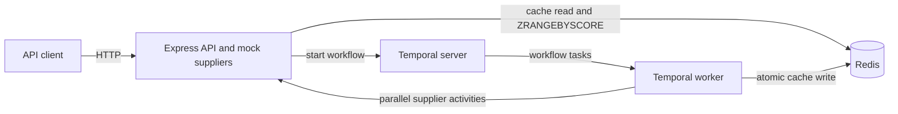

# Hotel Offer Orchestrator

A small TypeScript service that combines hotel offers from two mock supplier APIs. A Temporal workflow fetches both suppliers concurrently, keeps the best offer for each normalized hotel name, and stores the results in Redis. The Express API serves cached offers and applies price ranges inside Redis.

## Features

- Express API with input validation, request IDs, structured logs, health checks, and consistent error responses.
- A small browser landing page at `/` with links to the main API examples.
- Two mock supplier APIs with overlapping catalogues and optional failure injection.
- Temporal workflow with parallel supplier activities, retries for transient errors, and partial results when one supplier fails.
- Name-based deduplication, choosing the cheapest offer; equal prices use commission and supplier name as deterministic tie-breakers.
- Redis Sorted Set storage for price ordering and inclusive `minPrice` / `maxPrice` queries.
- Docker Compose setup for the API, Temporal worker, Temporal dev server, and Redis.

## Tech stack

| Area | Technology |
| --- | --- |
| Runtime and language | Node.js 22, TypeScript |
| HTTP API | Express 5 |
| Workflow orchestration | Temporal TypeScript SDK |
| Cache and price index | Redis 7, `ioredis` |
| Validation and logging | Zod, Pino |
| Tests | Vitest, Supertest, Temporal test server |
| Local infrastructure | Docker Compose |

## Architecture



On a cache miss, the API starts `hotelOffersWorkflow`. The worker executes the workflow and its activities; supplier HTTP calls and Redis writes happen in activities. The mock supplier routes are hosted by the API service.

## Prerequisites

- Docker Desktop or Docker Engine with the Compose v2 plugin.
- For local development without Docker: Node.js 22 (Node.js 20 or newer is supported), npm, Redis, and a Temporal server.

## Start with Docker Compose

From the project directory:

```bash
docker compose up -d --build
docker compose ps
```

Compose runs the API at `http://localhost:3000`, Temporal's Web UI at `http://localhost:8233`, Temporal gRPC on port `7233`, and Redis on port `6379`. A short-lived initializer sets the named SQLite volume ownership required by the Temporal container. The initializer exits after setup; the four application services remain running.

Try the API:

```bash
curl "http://localhost:3000/health"
curl "http://localhost:3000/api/hotels?city=delhi"
curl "http://localhost:3000/api/hotels?city=delhi&minPrice=5000&maxPrice=10000"
```

Stop the services and retain the Temporal database:

```bash
docker compose down
```

Remove the services and their named data volumes:

```bash
docker compose down --volumes
```

The Compose Temporal service is a local development server backed by SQLite. It is not a production Temporal deployment. The image tag defaults to `latest`; optionally set `TEMPORAL_VERSION` in the Compose `.env` file to pin a tag.

## API

### Landing page

`GET /` serves a simple browser page with clickable links for liveness, dependency health, Delhi hotel offers, price filtering, and both mock suppliers. The API still returns JSON from its API routes.

### Hotel offers

```http
GET /api/hotels?city=delhi[&minPrice=5000][&maxPrice=10000][&refresh=true]
```

| Parameter | Required | Behavior |
| --- | --- | --- |
| `city` | Yes | Trimmed and lowercased; maximum 64 characters. Interior whitespace is preserved. |
| `minPrice` | No | Inclusive, finite, non-negative number. |
| `maxPrice` | No | Inclusive, finite, non-negative number. |
| `refresh` | No | `true` bypasses the cache and starts a workflow; accepted values are `true` and `false`. |

The minimum cannot exceed the maximum. A successful response is a bare JSON array sorted by price ascending. For example:

```bash
curl "http://localhost:3000/api/hotels?city=delhi"
```

```json
[
  { "name": "Hotel Aravali", "price": 2900, "supplier": "Supplier A", "commissionPct": 8 },
  { "name": "Ibis", "price": 3800, "supplier": "Supplier B", "commissionPct": 12 },
  { "name": "Lemon Tree", "price": 4200, "supplier": "Supplier A", "commissionPct": 11 },
  { "name": "Holtin", "price": 5340, "supplier": "Supplier B", "commissionPct": 20 }
]
```

The example is abbreviated; the default Delhi catalogue produces eight deduplicated offers. A city with no offers returns `200` and `[]`.

Operational metadata is returned in headers:

| Header | Meaning |
| --- | --- |
| `X-Cache` | `HIT`, `MISS`, or `REFRESH`. |
| `X-Workflow-Id` | Temporal workflow ID when a workflow ran. |
| `X-Data-Degraded` | `true` when one supplier failed and partial offers are returned. |
| `X-Failed-Suppliers` | Failed supplier labels when the result is degraded. |
| `X-Request-Id` | Correlation ID; an incoming ID up to 128 characters is propagated. |

Errors use `{ "error": { "code", "message", "details?", "requestId" } }`:

| HTTP | Code | Example condition |
| --- | --- | --- |
| 400 | `VALIDATION_ERROR` | Missing or invalid query parameter. |
| 404 | `NOT_FOUND` | Unknown route. |
| 500 | `INTERNAL_ERROR` | Unexpected server error; internal details are not returned. |
| 502 | `UPSTREAM_UNAVAILABLE` | Both suppliers failed after retries. |
| 503 | `DEPENDENCY_UNAVAILABLE` | Redis or Temporal is unavailable. |
| 504 | `GATEWAY_TIMEOUT` | The workflow timed out. |

### Health checks

- `GET /health/live` is a dependency-free liveness check used by the API container.
- `GET /health` probes Redis, Temporal, and both supplier URLs. It returns `200` for `ok` or `degraded`, and `503` when Redis or Temporal is down or both suppliers are down.

### Mock supplier APIs

- `GET /supplierA/hotels?city=delhi`
- `GET /supplierB/hotels?city=delhi`

Supplier responses contain `hotelId`, `name`, `price`, `city`, and `commissionPct`. The seeded catalogues cover Delhi, Mumbai, and Bangalore. An unknown city returns an empty array.

When `MOCK_CHAOS_ENABLED=true`, the demo supports `POST /supplierA/_chaos` and `POST /supplierB/_chaos` with JSON such as `{ "down": true }` or `{ "latencyMs": 1000 }`. State is in memory per API process and is intended for local demonstrations only. The Postman failure scenarios require chaos endpoints to be enabled.

## Temporal workflow

The API uses the deterministic workflow ID `hotel-offers:<city>` and `USE_EXISTING` conflict policy so concurrent requests for an in-flight city aggregation can attach to the same execution. Once there is no running execution, a later cache miss can start a new run.

The workflow:

1. Schedules the Supplier A and Supplier B fetch activities concurrently.
2. Retries transient HTTP, timeout, and connection errors up to three attempts. HTTP 4xx responses and invalid JSON shapes are non-retryable. Invalid individual records are skipped and logged.
3. Returns a degraded result and marks the failed supplier if one supplier fails. If both fail, the API responds with `502`.
4. Normalizes hotel names by Unicode decomposition, accent removal, trimming, whitespace collapse, and lowercasing. The cheapest offer wins; equal prices prefer higher commission, then the alphabetically earlier supplier label.
5. Saves the result through a Redis activity and returns the offers.

## Redis cache and price filtering

For each normalized city, the repository uses:

| Key | Type | Contents |
| --- | --- | --- |
| `hotels:v1:<city>:by_price` | Sorted Set | Score is offer price; member is the offer JSON. |
| `hotels:v1:<city>:meta` | String | Update time, count, degraded flag, and failed suppliers. |

The sorted set is queried with `ZRANGEBYSCORE` using the requested price bounds (`-inf` and `+inf` for open bounds). Filtering and ordering happen in Redis, without loading the full city list into the API. Writes and paired metadata/range reads use Redis transactions. Complete results use `CACHE_TTL_SECONDS` (60 seconds by default); degraded results use `DEGRADED_CACHE_TTL_SECONDS` (10 seconds by default). Empty city results are cached using the metadata key.

## Configuration

`.env.example` lists the runtime defaults and contains no credentials. The Node.js processes validate their environment at startup. Node does not automatically load `.env`; export variables in the shell, or use Node's `--env-file=.env` option when running compiled entrypoints. Docker Compose supplies its own container network addresses (`redis`, `temporal`, and `api`) and service settings.

| Variable | Default | Purpose |
| --- | --- | --- |
| `NODE_ENV` | `development` | Runtime mode: `development`, `test`, or `production`. |
| `PORT` | `3000` | API listening port. |
| `LOG_LEVEL` | `info` | Pino log level. |
| `REDIS_URL` | `redis://localhost:6379` | Redis connection URL. |
| `TEMPORAL_ADDRESS` | `localhost:7233` | Temporal frontend address. |
| `TEMPORAL_NAMESPACE` | `default` | Temporal namespace. |
| `TEMPORAL_TASK_QUEUE` | `hotel-offers` | Queue shared by API and worker. |
| `WORKFLOW_TIMEOUT_SECONDS` | `30` | Workflow execution timeout requested by the API. |
| `SUPPLIER_A_URL` | `http://localhost:3000/supplierA/hotels` | Supplier A endpoint. |
| `SUPPLIER_B_URL` | `http://localhost:3000/supplierB/hotels` | Supplier B endpoint. |
| `SUPPLIER_TIMEOUT_MS` | `3000` | Timeout per supplier activity attempt. |
| `CACHE_TTL_SECONDS` | `60` | Complete result cache TTL. |
| `DEGRADED_CACHE_TTL_SECONDS` | `10` | Partial result cache TTL. |
| `MOCK_CHAOS_ENABLED` | `true` | Enables mock supplier failure-injection routes. |

The Compose-only `TEMPORAL_VERSION` variable selects the `temporalio/temporal` image tag; Compose defaults to `latest` when it is unset.

## Run without Docker

Start Redis and a Temporal dev server separately, then install dependencies and run the API and worker in separate terminals:

```bash
npm ci
npm run dev:worker
npm run dev:api
```

The defaults target local Redis, Temporal, and supplier routes. Set environment variables in each shell before starting the processes if your local addresses differ. To run the compiled entrypoints with a `.env` file:

```bash
npm run build
node --env-file=.env dist/worker.js
node --env-file=.env dist/server.js
```

## Tests and verification

```bash
npm ci
npm run typecheck
npm run build
npm test
```

The workflow tests use a Temporal server at `localhost:7233` when one is running (for example, from Docker Compose). Set `TEMPORAL_TEST_ADDRESS` to use another server. If no external server is available, the tests start Temporal's local test server, which may download its executable the first time; set `TEMPORAL_CLI_PATH` to an existing compatible CLI executable to avoid that download. The Redis repository integration tests connect to `REDIS_URL` (default `localhost:6379`) and skip when Redis is unreachable.

Verification performed for this checkout:

- `npm run typecheck` — passed.
- `npm run build` — passed.
- `npm test` — 45 tests passed (includes Temporal workflow and Redis integration tests).
- Newman Postman run — 26 requests and 66 assertions passed against the running Compose stack.
- `docker compose up -d --build` — API, worker, Temporal, and Redis started; `/health` returned `ok`; a forced Delhi aggregation returned `200` with eight offers and a workflow ID; the `5000`–`10000` price query returned `200` from cache with three matching offers.

## Postman collection

Import [`postman/hotel-offer-orchestrator.postman_collection.json`](postman/hotel-offer-orchestrator.postman_collection.json) into Postman. Its `baseUrl` variable defaults to `http://localhost:3000`; it contains 26 requests for the home page, health, hotel offers, cache behavior, price ranges, validation, supplier failure and recovery, and the supplier APIs. Run all requests sequentially and confirm every assertion passes; the supplier-failure folder changes in-memory chaos state and restores it near the end. The full ordered checklist is in [`postman/POSTMAN_TESTING.md`](postman/POSTMAN_TESTING.md). Newman can run the collection with:

```bash
npx newman run postman/hotel-offer-orchestrator.postman_collection.json
```

## Project structure

```text
.
|-- .dockerignore
|-- .env.example
|-- .gitignore
|-- Dockerfile
|-- docker-compose.yml
|-- package.json
|-- package-lock.json
|-- postman/
|   |-- POSTMAN_TESTING.md
|   `-- hotel-offer-orchestrator.postman_collection.json
|-- src/
|   |-- activities/index.ts
|   |-- api/
|   |   |-- app.ts
|   |   |-- health.routes.ts
|   |   |-- home.routes.ts
|   |   |-- hotels.routes.ts
|   |   `-- middleware.ts
|   |-- config/index.ts
|   |-- domain/dedupe.ts
|   |-- mock/
|   |   |-- supplier.data.ts
|   |   `-- supplier.routes.ts
|   |-- services/
|   |   |-- health.service.ts
|   |   |-- hotel-offers.service.ts
|   |   |-- hotel.repository.ts
|   |   |-- redis.ts
|   |   |-- supplier.client.ts
|   |   `-- temporal.provider.ts
|   |-- types/hotel.ts
|   |-- utils/
|   |   |-- errors.ts
|   |   `-- logger.ts
|   |-- worker.ts
|   |-- server.ts
|   `-- workflows/
|       |-- hotel-offers.workflow.ts
|       `-- index.ts
|-- tests/
|   |-- api.test.ts
|   |-- dedupe.test.ts
|   |-- hotel.repository.test.ts
|   `-- workflow.test.ts
|-- tsconfig.json
|-- tsconfig.build.json
`-- vitest.config.mts
```

## Troubleshooting and limitations

- Check `GET /health` and `docker compose ps` first. Use `docker compose logs api worker temporal redis` for service logs.
- If a hotel request returns `503`, check that Temporal and Redis are healthy. Temporal's dev server needs write access to its SQLite volume; Compose runs `temporal-data-init` to set that up.
- Use `refresh=true` to bypass a cached result while debugging. Otherwise, a result can remain cached until its TTL expires.
- If ports `3000`, `6379`, `7233`, or `8233` are already in use, stop the conflicting service or adjust the Compose port mappings.
- Workflow tests may need network access the first time to download Temporal's test server. Redis integration tests need a reachable Redis instance to run rather than skip.
- The suppliers are deterministic mocks; chaos state is process-local. There is no pagination, currency model, supplier authentication, or production Temporal/Redis deployment configuration in this project.
